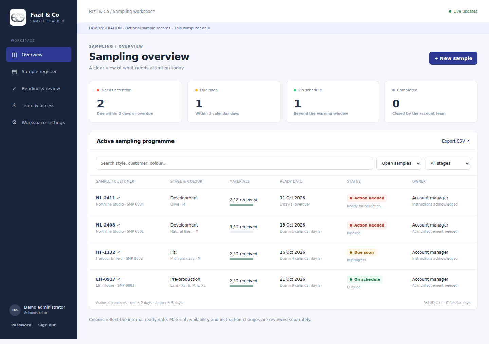
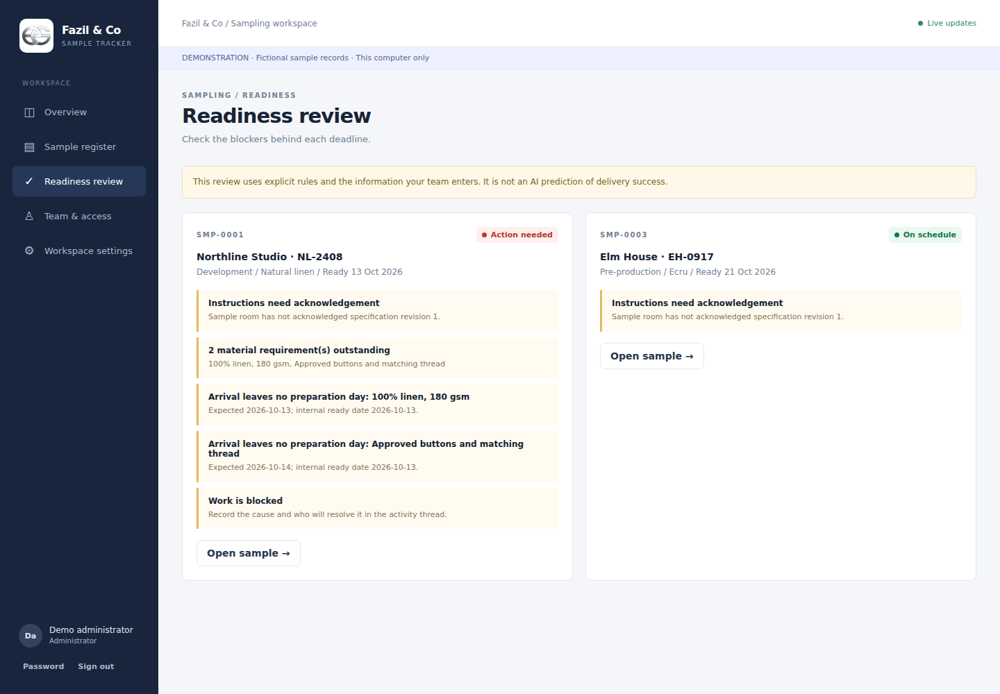
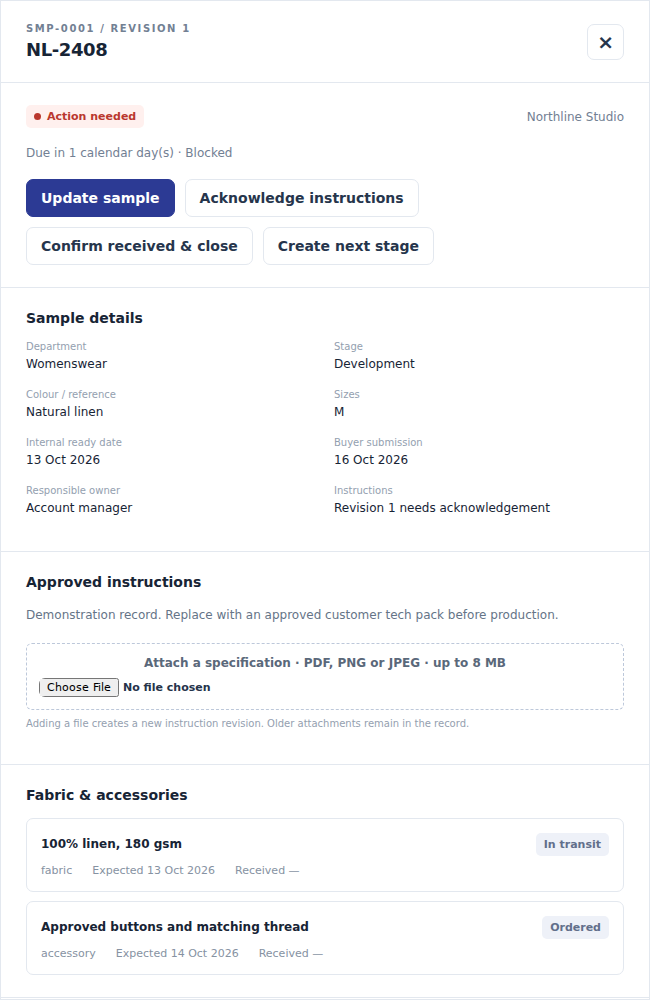

# Fazil Samples

### Digitising garment sample tracking in a family textile business

**Project lead: Adil Maqsood · Node.js / SQLite / Electron · Working prototype**

Fazil Samples brings sample deadlines, fabric and accessory readiness, approved instructions and handover records into one workspace. I initiated the project to help move a largely manual sampling process towards shared digital tracking, and am coordinating a factory pilot with IT.



*Actual prototype interface. All customers, samples and accounts shown here are fictional demonstration records.*

## The business problem

Sample preparation depends on several people and prerequisites: materials must arrive, instructions must be current, the sample room must complete the work, and the account team must confirm receipt. A due date alone does not show which of these steps is blocking delivery.

The project aims to make those dependencies visible in one record, with clear ownership and a consistent deadline view across factory laptops.

## My contribution

- Defined the initial product requirements around materials, deadlines and red/amber/green status flags.
- Used AI-assisted development to turn those requirements into a working desktop and browser prototype.
- Shaped the interface and workflow through iteration, including the application identity and intro animation.
- Coordinated with factory IT on a separate Windows VM environment and remote access for the pilot.

**AI-assisted development:** AI coding tools supported implementation and testing. My contribution focused on requirements, product decisions and coordination with factory IT.

## What the prototype does

| Capability | Operational purpose |
| --- | --- |
| Shared sample register | Keep style, colour, sizes, owner and due dates together |
| Fabric and accessory tracking | Surface outstanding materials separately from deadline status |
| Red / amber / green flags | Identify samples that are overdue or nearing their internal ready date |
| Four user roles | Separate sample-room updates, account-team decisions and administration |
| Instruction revisions and acknowledgement | Make changed specifications visible before work continues |
| Handover history | Record updates, reasons for changes and manager-confirmed completion |

The four roles are **administrator, account manager, merchandiser and sample room**. Readiness checks use explicit rules; they are not AI predictions.

## See the workflow

1. A merchandiser creates a sample with an owner, due date, material requirements and instructions.
2. The sample room acknowledges the current instructions and updates material receipts and progress.
3. The readiness view highlights missing materials and other blockers alongside the deadline colour.
4. An account manager confirms receipt and closes the sample. Reopening requires a reason.

<details>
<summary>View readiness and sample-detail screenshots</summary>





</details>

## Status and evidence

**As of 12 October 2026:** the prototype is implemented, and factory IT has supplied a VM environment. Application installation, shared factory access and staff acceptance testing are still being arranged. No measured operational savings or production adoption are claimed yet.

| Evidence | Current position |
| --- | --- |
| Functional prototype | Desktop shell and browser interface with a shared backend |
| Automated checks | Three test groups pass on Node.js 24.19.0 / Linux; see [validation](docs/VALIDATION.md) |
| Browser walkthrough | Local demonstration checked using fictional records |
| Factory pilot | Infrastructure provided by IT; application rollout and acceptance testing pending |

Once the pilot is running, the intended measures are active users, samples tracked, time spent chasing status updates, and on-time completion against the original due date. A before-and-after comparison is needed before claiming improvements.

## Technical overview

| Layer | Implementation |
| --- | --- |
| Desktop | Electron shell with an isolated renderer |
| Interface | HTML, CSS and JavaScript |
| Backend | Node.js HTTP API with server-side validation and permissions |
| Storage | SQLite database and a separate attachment directory |
| Shared updates | Server-Sent Events and record-version conflict checks |
| Authentication | Hashed passwords, cookie sessions and CSRF checks |

See [architecture and design decisions](docs/ARCHITECTURE.md) for the data flow, role permissions and trade-offs.

## Run the fictional demo locally

Use **Node.js 24 LTS**. The browser demo and tests have no third-party runtime dependencies, so `npm install` is not needed for these commands.

```bash
node server.mjs --demo
```

Open `http://127.0.0.1:4310` in your browser. On Windows you can also run `START-DEMO.cmd` after installing Node.js 24.

| Demo role | Username |
| --- | --- |
| Administrator | `admin` |
| Account manager | `manager` |
| Merchandiser | `merch` |
| Sample room | `room` |

The local demo password is `Fazil-Demo-2026!`. These are intentionally public **fictional demo credentials**, not factory accounts. Keep demo mode on localhost. Its records persist in the local `demo-data` directory, which is excluded from version control.

Run the automated checks with:

```bash
npm test
```

For Electron development, `npm ci` installs the desktop tooling and `npm run desktop` starts the desktop demo. Native packaging scripts are included, but this public copy has not been independently packaged and tested on every target operating system.

## Scope of this repository

This is the public portfolio edition. It includes the prototype source, tests and fictional demo images. It excludes factory databases, customer documents, remote-access credentials, server addresses and deployment configuration. A planning-only camera-AI page from the internal draft has been omitted to keep this edition focused on implemented sampling features.

Current limitations include calendar-day deadlines rather than a factory working-day calendar, no offline write queue, shared visibility of the sample register across active users, and backup automation that must be configured during deployment. The code has not undergone an independent security audit.
