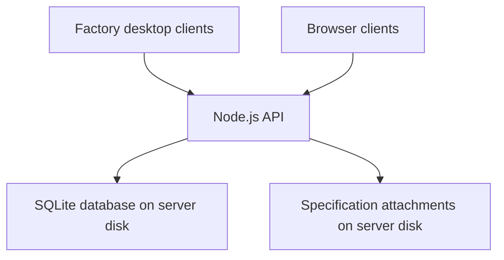

# Architecture and design decisions

This document describes the prototype, not a verified production deployment.

## Shared data flow

For a shared deployment, both types of client connect to the same HTTPS workspace. Server-Sent Events tell connected clients when data changes. Record versions prevent one person's stale edit from silently overwriting another person's changes.

The local demo runs the same backend on the user's own computer with fictional accounts and samples. That local database is separate from a future shared factory workspace.

## Why these choices

| Decision | Rationale and trade-off |
| --- | --- |
| Central API rather than a database file shared across laptops | One place for validation, permissions and writes; clients do not open a SQLite file over a network share |
| SQLite for the initial pilot | Simple installation and a single database file; actual workload and concurrency still need to be measured before wider rollout |
| Browser interface inside an Electron shell | Supports the requested desktop experience while retaining browser access |
| Separate deadline and readiness checks | A sample can be far from its due date but blocked by missing fabric or unacknowledged instructions |
| Instruction versioning and acknowledgement | A changed specification requires a fresh acknowledgement |
| Manager-confirmed completion | Sample-room readiness and account-team receipt are distinct events |
| Calendar dates in Asia/Dhaka | Consistent deadline flags across users; holidays and working-day calendars remain future work |

## Roles

| Role | Main permissions |
| --- | --- |
| Administrator | Manage accounts and settings; create and update samples; acknowledge instructions; complete/reopen samples; create database snapshots |
| Account manager | Create and update samples; acknowledge instructions; complete and reopen samples |
| Merchandiser | Create and update sample information and specifications |
| Sample room | Acknowledge instructions; update work status and material receipts |

All active accounts can currently view the shared sample register. Role permissions limit actions, not buyer-specific visibility.

## Storage and controls

- The database stores users, sessions, settings, samples, activity and attachment metadata.
- Specification files are stored separately and downloaded through authenticated API routes.
- Passwords are hashed using scrypt. Sessions use HttpOnly cookies, with Secure cookies enabled for an HTTPS deployment.
- Mutations use server-side role checks, validation and CSRF protection.
- The API uses prepared statements. Sample payloads are stored as JSON alongside version and audit metadata.
- A database backup does not include attachment bytes; a recovery process needs both.

## Implementation map

| File or directory | Purpose |
| --- | --- |
| `server.mjs` | HTTP API, authentication, SQLite storage and live notifications |
| `domain.mjs` | Validation, deadline colours and readiness rules |
| `public/` | Browser interface and application artwork |
| `desktop/` | Electron shell and restricted preload bridge |
| `test/workflows.test.mjs` | Domain, workflow, permission and persistence checks |

Factory addresses and remote-access configuration are intentionally absent from this repository. The public demo is intended for local use.
